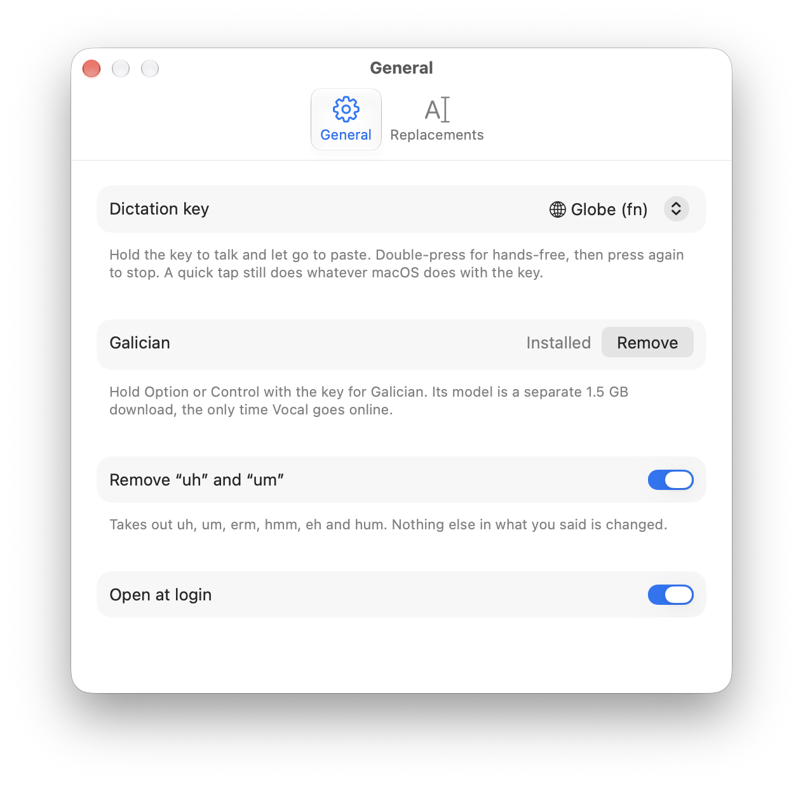
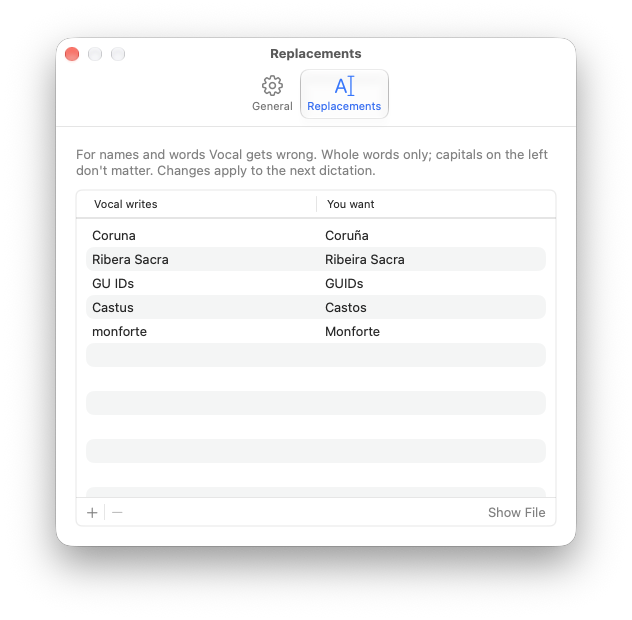

# Vocal

A Mac dictation app: hold a key, talk, let go, and the text lands where the cursor is (Slack, Mail, a terminal, a text editor). Everything runs on the Mac. No audio or text leaves it, no account, no subscription.

It writes down exactly what you said. There's no AI step that rewrites or "cleans up" your words; the only changes are the ones you set up yourself (replacements, and optionally removing "uh" and "um").

*English and Spanish work today, including Spanish words and place names inside English sentences. Galician is planned.*

## Download

Get **Vocal-x.y.z.zip** from [Releases](https://github.com/amongthestones/vocal/releases/latest), unzip it and drag **Vocal** to Applications. It's signed with a Developer ID and notarized by Apple, so it opens like any other app. The speech model is inside it (that's why the download is about 560 MB), so Vocal never needs the internet.

Needs macOS 15 or later on a Mac with Apple Silicon (M1 or newer).

## First launch

Vocal lives in the menu bar (a waveform icon); it has no Dock icon or window. On first launch it asks for three permissions, one at a time:

1. **Microphone**, to hear you. Click Allow.
2. **Input Monitoring**, to notice when you hold the key. macOS opens System Settings; turn on Vocal.
3. **Accessibility**, to paste the text with ⌘V. Turn on Vocal in the same way.

Vocal notices each switch by itself. If macOS asks you to quit and reopen Vocal, or the menu says **Restart Vocal to finish setup**, choose **Restart Vocal** in the menu. When the menu bar icon is a plain waveform, it's ready: click into any text field, hold Globe (fn), talk, and let go.

## Build from source

You need the Xcode command line tools with Swift 6.2 (`xcode-select --install`, or Xcode 26).

```sh
git clone https://github.com/amongthestones/vocal.git
cd vocal
./scripts/install-model.sh    # downloads the speech model once (about 630 MB) into ~/Library/Application Support/Vocal
./scripts/package-app.sh      # builds, signs and installs /Applications/Vocal.app
open /Applications/Vocal.app
```

`package-app.sh` signs with your Developer ID or Apple Development certificate if you have one, so macOS keeps the permissions across rebuilds. Without one it signs ad hoc, and you'll have to grant the permissions again after each rebuild. `swift test` runs the tests.

## Using it

- **Hold Globe (fn)**, talk, let go. Recording starts after a beat (0.25 s); the text is pasted where the cursor is.
- **Double-press Globe** for hands-free. Press it again to stop, or Esc to cancel.
- A quick tap never starts Vocal, so Globe keeps its macOS job (switching the keyboard, emoji). Globe with another key (a shortcut) cancels too.
- The menu bar icon shows the state: waveform (ready), filled waveform circle (listening; macOS adds its own mic indicator), dots (writing it out), triangle (something needs fixing; the menu says what).

If macOS also acts on Globe after a long hold, set System Settings > Keyboard > Press Globe key to: Do Nothing, or switch Vocal's key to right Option or right Command in Settings.

### Menu

- **Status**, with the key drawn as its SF Symbol.
- **Copy Last Dictation**: for when the paste went to the wrong place.
- **Open History**: every dictation, one per line with the time.
- **Settings…** (⌘,)

### Settings

- **General**: dictation key (Globe, right Option or right Command), remove "uh" and "um" (off by default; plain removal from a fixed list), open at login.
- **Replacements**: a table of what Vocal writes and what you want, for names it can't know ("Coruna" → "Coruña"). Whole words, capitals on the left don't matter, applies to the next dictation. It's saved to `replacements.txt`, which you can also edit by hand (Show File).

<p>
  
  
</p>

`open /Applications/Vocal.app --args --settings 1` opens straight to a Settings tab (0 General, 1 Replacements), and `--menu` opens the menu bar menu, for checking them after changes.

## Files

Everything lives in `~/Library/Application Support/Vocal/`:

| File | What it is |
|---|---|
| `Models/parakeet-ultra/` | The speech model, for builds from source (a downloaded Vocal carries its own) |
| `replacements.txt` | Your find-and-replace rules |
| `history.txt` | Everything you've dictated |
| `vocal.log` | State changes and errors, never what you said |

## Troubleshooting

- **Nothing happens when I hold the key.** Open the menu: the first line says what's missing. "Needs Input Monitoring" or "Needs Accessibility" comes with a button to the right page of System Settings. If both switches are on and it still doesn't react, choose Restart Vocal, or quit and open it again.
- **It listens, but nothing is pasted.** Check the microphone in System Settings > Sound > Input. On a MacBook with the lid closed, the built-in microphone sends only silence. `vocal.log` (see Files) shows "peak 0.000" when the mic gave silence.
- **The text went to the wrong place.** Choose Copy Last Dictation and paste it yourself.
- **Globe also switches the keyboard or opens emoji.** Quick taps go to macOS on purpose. If macOS acts after a long hold too, set System Settings > Keyboard > Press Globe key to: Do Nothing, or pick right Option or right Command in Vocal's Settings.
- **A name keeps coming out wrong.** Add it in Settings > Replacements.

## Uninstall

1. Quit Vocal from its menu and drag it from Applications to the Trash.
2. Delete `~/Library/Application Support/Vocal` (your history, replacements and, for builds from source, the model).
3. In System Settings > Privacy & Security, remove Vocal from Microphone, Input Monitoring and Accessibility.

## How it works

| File | Job |
|---|---|
| `KeyWatcher.swift` | Listen-only event tap: sees the trigger key, never blocks or changes keys |
| `PressLogic.swift` | Hold, tap, double-press and cancel rules (tested) |
| `Recorder.swift` | Microphone into memory; only runs while recording |
| `Transcriber.swift` | Parakeet Ultra through FluidAudio, loaded from disk with `loadLocal`, which never downloads |
| `TextRules.swift` | Replacements and filler removal (tested) |
| `Paster.swift` | Copy, ⌘V, then restore the old clipboard |
| `SettingsWindow.swift` | The Settings window |

The app icon is drawn by `scripts/make-icon.swift` into `Resources/AppIcon.png`; `package-app.sh` turns it into the `.icns`.

**Network.** Vocal has no network code of its own, and FluidAudio's `loadLocal` reads only from disk. The app isn't sandboxed (an event tap and posting ⌘V need that), so the guarantee comes from the code rather than a sandbox. To check it yourself: `lsof -a -i -p $(pgrep -x Vocal)` should print nothing.

## Why Parakeet Ultra

Picked by running real dictation through three models side by side. On recordings with English, Spanish and Galician place names, Parakeet Ultra and Desert Ant's Voz (both Parakeet v3 underneath) got technical terms like "GUIDs" and "SaaS" and the Galician names right, in about 0.1 s per clip. Whisper large-v3 turbo was better with Spanish accents but split "GUIDs" in two, misspelled a Galician name, rewrote "gonna" as "going to" when given a word list, and took 1 to 1.6 s. Voz's word list changed nothing and its SDK reports each model load to Desert Ant's server, so Parakeet Ultra (Apache 2.0 library, no reporting) won.

## Later

- Galician: none of the tested models support it.
- FluidAudio's vocabulary boosting, if replacements aren't enough.
- A sound or visual cue when recording starts.

## Credits and license

Vocal is MIT licensed (see `LICENSE`).

- Speech recognition by [FluidAudio](https://github.com/FluidInference/FluidAudio) (Apache 2.0).
- The model is [Parakeet Ultra](https://huggingface.co/FluidInference/parakeet-ultra-coreml) (CC BY 4.0), Moondream's post-training of NVIDIA's [Parakeet TDT 0.6B v3](https://huggingface.co/nvidia/parakeet-tdt-0.6b-v3). It isn't in this repository: `install-model.sh` downloads it for builds from source, and release builds include it.
